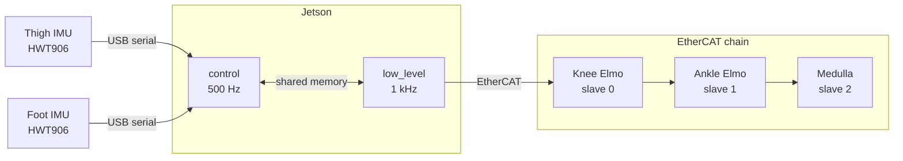

# Hardware

A system diagram of the hardware is given below:

The prosthesis is driven by high-torque motors through harmonic drives. Both joints are series elastic actuators (SEA), which means a physical spring sits between the motor and the joint. This enables us to read joint torques directly from the deflection of that spring, without having to rely on torque sensors. The torque is also transmitted to the load through the spring, so the motor does not take a significant shock on impact.

The motors are driven by two Elmo drives (refer to the Box folder for more information on the models), one each for the knee and ankle. Each joint has three encoders: one on the motor side, one on the joint side of the spring, and a third directly on the motor shaft. We usually rely on only the first two for control. These encoders are connected to a microcontroller board called the Medulla, through which we read the data.

All the control software runs on our host computer, a Jetson Orin Nano. The computer talks to the two Elmo drives and the Medulla over the EtherCAT communication protocol.
